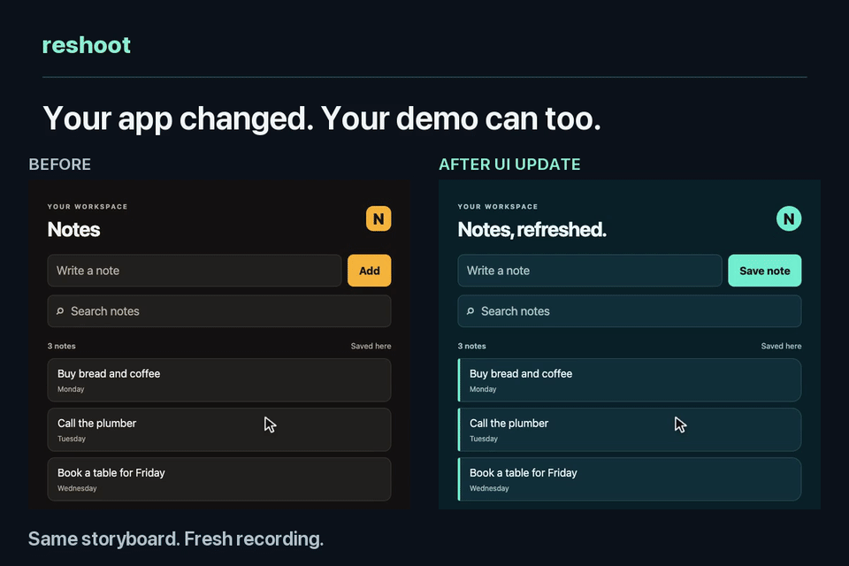

# reshoot

**Demos that stay current.**

Script a task in your app once. reshoot records it as a captioned MP4 and a
README GIF, checks that the result really appeared, and keeps the script beside
your code. When the UI changes, run it again: the same story, freshly recorded.



Before and after a UI change, from one storyboard.
[Watch the 21-second social cut](docs/demo/reshoot.mp4).

- **Re-record, don't redo.** The demo is a `storyboard.toml` of clicks, typing,
  captions and the result that should appear. Run it after every UI change.
- **Checked, not just captured.** Each run confirms that the result you named
  appeared, such as a saved item or a search match, and stops on the exact step
  whose control or label no longer matches. It scans the frames for email
  addresses, keys and, on macOS, faces before you share anything.
- **Your agent can drive it.** Skills for Claude Code and Codex write the story
  from your app, and a GitHub workflow records it again when the app changes and
  opens a pull request with the new video.

## Try it in a minute

```bash
uv tool install 'reshoot[browser]'
reshoot create                  # make the notes preview and open the studio
```

With the dependencies installed, the preview takes seconds. In the studio,
change a caption or result hold, choose **Update preview**, then **Make final**
when it looks right. Undo keeps experiments easy to reverse.
The status above the preview tells you whether saved edits are in the shown
recording. Jump between sections, inspect the final, then use **Download** to
get its videos, screenshots, walkthrough and subtitles together.

**Style and exports** offers Focus, Midnight and Paper looks, plus saved styles
you can reuse in another project. Update preview shows the chosen look using
the existing recording when the story is still current.
**Your cut** trims clips by beat and rearranges or repeats them, while the
recording still runs the full task and its checks.
Framing controls and a viewing-size inspector help spot small or clipped text
in each export before sharing.
Add a spoken line under a step's **Narration** and audition it before recording.
**Audio** chooses the voice and balances narration against music.
**Use for docs** turns a checked result into a named PNG that refreshes with
the video, with alt text and review included.
**Clickable tour** turns checked steps into an offline HTML walkthrough, with
explanations, optional click markers and keyboard navigation.

For your own running demo app:

```bash
reshoot create http://127.0.0.1:3000/ --directory my-demo
```

Show one task in the fresh browser. Its toolbar adds captions, checks a result,
hides an element, pauses, and finishes. Choose **Done** to make the preview and
open it in the studio. Use a demo account and resettable made-up data.

Each preview prints what it made:

```text
Done in 13 s: 3 of 3 result checks passed · scan: 6 items, 0 flagged · not accepted yet.
  video  demo/takes/runs/RUN_ID/takes/demo-final.mp4
  GIF    demo/takes/runs/RUN_ID/takes/demo-final-readme.gif
  review demo/takes/runs/RUN_ID/review.html

This is a preview, smaller and quicker than a final. When it looks right, record the final:
  reshoot run demo/reshoot.toml
```

reshoot runs on macOS or Linux with Python 3.11+, ffmpeg and Chrome or
Chromium, plus Tesseract on Linux; [installation](guide/install.md) covers each
platform. The
[CLI tutorial](guide/step-by-step.md) shows the part only reshoot does: change
the app, watch the story stop on the beat that broke, fix one line, and compare
the new recording with the old one.

## Or let your agent make it

Open **Claude Code or Codex** in your app's repository, or in an empty folder
if you only have a running app, and paste:

```text
Make a short demo with reshoot.
Read https://github.com/mumit/reshoot/blob/main/guide/agent-quickstart.md
and follow its setup and creation workflow.

Target: the app in this repository.
Choose one useful task with a clear visible result. Use synthetic demo data.
Produce a short captioned MP4 and a README GIF. Keep the recording source in
demo/ so it can be updated later.

Inspect a preview, then record a fresh final and open both exports for review.
Ask only for permissions or missing details needed to proceed.
```

Change `Target:` to a URL, or to a macOS app and its window, if there's no
source. Add a task if you have one: "Show creating a project and finding it by
search."

What to expect, from [trials on four new apps](docs/validation/2026-10-23-cold-first-demo.md):

- **Time:** 2 to 3 minutes in Claude Code, 5 to 9 in Codex.
- **Files:** the agent writes `demo/` and its skills, in `.claude/skills/` or
  `.agents/skills/`, and leaves your README and other files alone.
- **Permissions:** it may ask to install reshoot and ffmpeg, and in Codex to
  run Chrome outside the sandbox.
- **At the end:** it opens the MP4 and GIF, and you reply "accept" or ask for
  changes, such as shorter captions. Nothing is published.
- **Agents:** Claude Code or Codex; either one is enough. reshoot calls no
  model and needs no API key. [What your agent needs](guide/agent-quickstart.md#what-your-agent-needs)
  covers the permissions, models tried, other agents, and making a demo with no agent.

## The story is a file

```toml
[[beat]]
id = "search"
caption = "Find the matching note"
hold = 2.0
[[beat.action]]
type = "type"
target = {css = "#q"}
text = "bike"
[[beat.expect]]
type = "text"
target = {css = "#list li"}
contains = "Pick up the bikes"
```

reshoot types into the real page with a visible cursor, shows the caption, and
holds on the result so people can read it. When the app renames `#q`, the run
stops on that beat: `type target {css = '#q'} matched 0 elements`. Fix the
target in the studio by choosing its replacement in the app, then run again.
Recorded alternatives can suggest a control; repairs always preserve the
expected result values. The [comparison](guide/publish.md) shows the same beats
with the same results.

## Keep it current

Record a final, watch it, and accept it once. That writes `demo/accepted/`, a
small record to commit with `demo/`:

```bash
reshoot run demo/reshoot.toml
reshoot accept demo/latest
```

After the app changes, record again and compare with the accepted run before
accepting the new one:

```bash
reshoot run demo/reshoot.toml
reshoot compare demo/accepted demo/latest --out demo/comparison.json
reshoot accept demo/latest
```

Or let CI do it: the [GitHub workflow](guide/ci.md) records the demo when the
app changes on `main` and opens a pull request with the new video, GIF and a
beat-by-beat comparison. A broken story fails on its beat and opens nothing.

## How it differs

| If you use | reshoot adds |
|---|---|
| Screen Studio, Loom, ScreenFlow | Re-recording on demand. You give up some hand polish; you never record the same flow by hand again |
| [VHS](https://github.com/charmbracelet/vhs) | The same idea for web apps and macOS windows. reshoot uses VHS for terminals |
| Playwright video | A cursor, typing, captions, zoom, cuts, a GIF, result checks and a privacy scan |
| Arcade, Supademo | Ordinary MP4 and GIF files, made locally from open source, that CI can refresh |

## What it records

| Show | How |
|---|---|
| A web app | Headless Chrome: the page only, never your desktop |
| A CLI or an agent at work | [VHS](https://github.com/charmbracelet/vhs) terminal recordings |
| A native app on macOS | One window, by its ID |
| A narrated explanation | Voiceover timed to the beats, music under it, subtitles |
| Other formats | Edits, portrait crops and size limits for each export |

Use made-up demo data. [Platforms and tested limits](guide/README.md#platforms)
lists what runs where.

## Skills for Claude Code and Codex

| When | Skill | Ask for |
|---|---|---|
| The first demo | [reshoot-demo](skills/reshoot-demo/SKILL.md) | "Show a customer saving a search and seeing its results." |
| The app changed | [reshoot-refresh](skills/reshoot-refresh/SKILL.md) | "Record that task again with the updated UI." |
| Before sharing | [reshoot-review](skills/reshoot-review/SKILL.md) | "Check the final video and GIF against the accepted run." |

The first-demo prompt installs them. To install them yourself, run
`reshoot skills claude --directory .` or `reshoot skills codex --directory .`
in the project, and add `--replace` after an upgrade. In Claude Code, the
plugin installs all ten: these three, plus seven supporting skills for
planning, recording, editing, privacy checks and CI:

```text
/plugin marketplace add mumit/reshoot
/plugin install reshoot@reshoot
```

The [agent quickstart](guide/agent-quickstart.md) has follow-up prompts for
refreshing and reviewing, and the [skill catalog](skills/README.md) describes
each skill.

## Where next

| To | Read |
|---|---|
| Record your own app | [A web app, from source or a URL](guide/your-app.md), or [a macOS window](guide/macos-window.md) |
| Change captions, timing or GIF size | [Change and grow a demo](guide/customize.md), or by pointing in [the studio](guide/customize.md#shape-it-in-the-studio): `reshoot studio demo` |
| See the cursor, zoom, captions and shapes | [How the videos look](guide/look.md) |
| Use it on a team | [Ownership, review, alerts and CI cost](guide/team.md) |
| Keep it current in CI | [GitHub Actions](guide/ci.md) |
| Look something up | [Project reference](guide/projects.md) · [Commands](guide/commands.md) · [Troubleshooting](guide/troubleshooting.md) |
| Rebuild the video above | [Before-and-after recipe](examples/promo/README.md) |

## Why reshoot exists

I made the launch video for [photosearch](https://github.com/mumit/photosearch)
this way, and pulled the tools and what I learned into reshoot. A demo takes
work to make. Keeping its story beside the app makes that work pay off again
every time the product changes.

The [original notes recording](docs/demo/notes.mp4) and its
[source files](examples/notes/) are still here.

## Contributing

New pitfalls, skills and fixes are welcome. See [CONTRIBUTING.md](CONTRIBUTING.md)
for how to work on it and [ROADMAP.md](ROADMAP.md) for what's planned.

## License

MIT. See [LICENSE](LICENSE).
