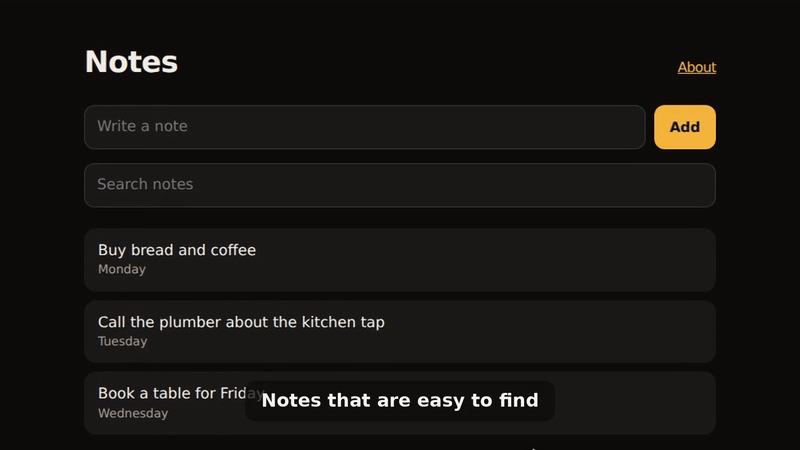

# reshoot

Demo videos of software, made from scripts, so you can shoot them again when the app changes.



The notes example, recorded and cut by `reshoot run` on a GitHub runner, with no one at the keyboard. Here's
[the full video](docs/demo/notes.mp4), with its terminal part and end card.

I made the launch video for [photosearch](https://github.com/mumit/photosearch) this way, and pulled the tools and
what I learned into this repo. It has:

- **a guide** to the whole process, with the pitfalls I hit ([guide/](guide/README.md));
- **a command-line tool**, `reshoot`, that records a web page from a storyboard, records one app window, puts
  everything a take can show on sheets to check by eye, and cuts the finished video;
- **Claude Code skills** that plan a video and run each step;
- **an example app** to try it all on ([examples/notes/](examples/notes/)).

## What it does

| Step | How |
|---|---|
| Plan | Write a storyboard: named beats, each an action, a caption and a hold. |
| Record a web page | `reshoot web storyboard.py takes/web.mp4` plays it in headless Chrome, with a drawn cursor, typing and captions, and zooms in on clicks and typing. Only the page is captured. |
| Record a terminal | [VHS](https://github.com/charmbracelet/vhs) plays a tape in a clean shell. |
| Record an app window | `reshoot window TextEdit takes/app.mov` records one window on macOS, never the whole screen. |
| Check | `reshoot check takes/web.assets.json takes/web.mp4` makes numbered sheets of every image the take can show, to look at before sharing. |
| Cut | A short Python edit script with `reshoot.cut`: trims at beat names, title and end cards, sped-up parts, a 9:16 version and GIFs. |
| Keep it current | `reshoot run` does the whole shoot from a `reshoot.toml`. A GitHub Action reshoots on each release and opens a pull request ([guide](guide/ci.md)). |

## Install

```bash
brew install ffmpeg vhs
uv tool install git+https://github.com/mumit/reshoot
```

On Linux, install ffmpeg and [VHS](https://github.com/charmbracelet/vhs#installation) from your package manager. Web
takes need Google Chrome or Chromium (or set `RESHOOT_CHROME` to its path). App windows need macOS. I've used reshoot
on macOS only so far; see [Platforms](guide/README.md#platforms).

**For Claude Code:**

```
/plugin install reshoot --marketplace mumit/reshoot
```

Then ask Claude to make a demo video of your app. The `plan-demo` skill starts it off.

## Try it

```bash
git clone https://github.com/mumit/reshoot && cd reshoot
reshoot run examples/notes/reshoot.toml
```

That starts the example app, records a web take and a terminal take, cuts them into a finished video with an end
card, a 9:16 version and a GIF, and makes review sheets, all in `takes/`.

## Rules I follow

- I record a headless browser page, a VHS terminal or one window. Never the whole screen.
- The app runs on demo data with nothing private in it.
- I look at every image a take can show, at full size, before cutting.
- I watch the whole video before posting it, and I post it myself.

## Skills

| Skill | For |
|---|---|
| [plan-demo](skills/plan-demo/SKILL.md) | Planning the takes and the storyboard. Start here. |
| [record-web](skills/record-web/SKILL.md) | A web page from a storyboard |
| [record-terminal](skills/record-terminal/SKILL.md) | A terminal or Claude Code take with VHS |
| [record-window](skills/record-window/SKILL.md) | One macOS app window |
| [check-privacy](skills/check-privacy/SKILL.md) | Checking everything a take can show |
| [cut-video](skills/cut-video/SKILL.md) | The finished video, 9:16 version and GIFs |
| [keep-current](skills/keep-current/SKILL.md) | `reshoot run` and reshooting in CI |

## Contributing

New pitfalls, skills and fixes are welcome. See [CONTRIBUTING.md](CONTRIBUTING.md), and [ROADMAP.md](ROADMAP.md) for what I'd like to build next.

## License

MIT. See [LICENSE](LICENSE).
