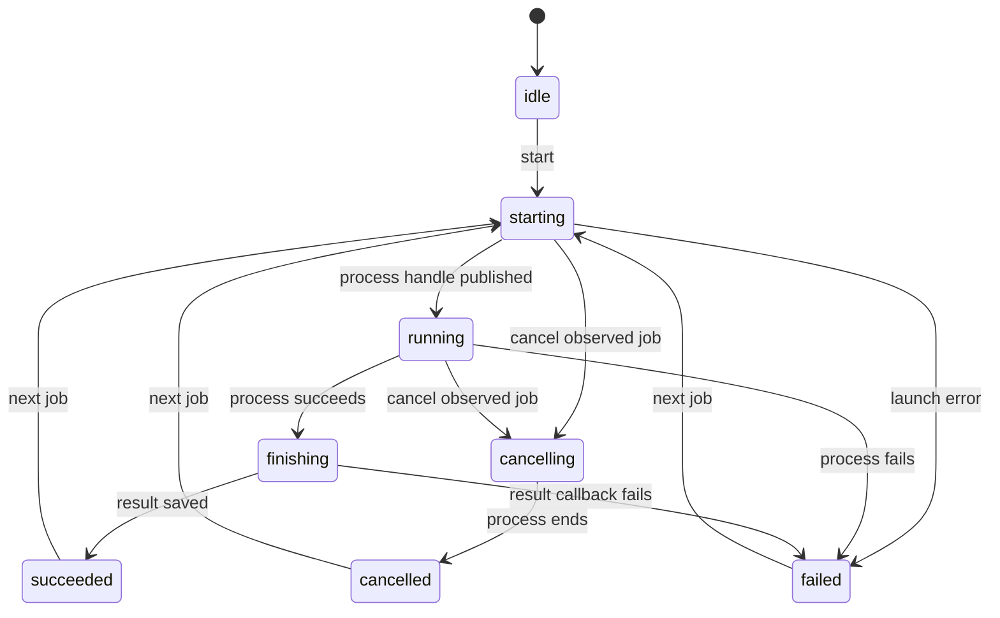

# State machines and lifecycle ownership

Audited November 8, 2026, starting at `c04bc01` (0.3.14), including the new
pull-request demo check and result-check comparison. This is an inventory of
the state-bearing subsystems found in the Python, JavaScript and CI workflows.
Some states are stored explicitly; others are inferred from files, booleans,
pending promises and process handles. Conceptual names below do not change
existing file schemas.

## Decision

Keep independent lifecycles separate. Share the rules that combine them into
available actions, rather than building one large state machine or making each
UI and agent reconstruct the rules.

- `journey.py` owns source freshness, update selection and action capabilities.
- `workflow.py` reads project evidence for the studio and read-only CLI status.
- `jobs.py` owns live studio job transitions and cancellation.
- Existing owners retain creation checkpoints, drafts, history, scanning and
  human decisions. Their saved formats and low-level commands remain compatible.
- Browser-only state stays in the browser: unsaved fields, selection, playback
  and request generations are not represented as durable project truth.

This improves UX through consistent next actions, DX through explicit ownership
and fewer UI dependencies, and AX through structured observations with stated
limits. It does not turn a successful command into permission to share.

## Inventory

| Lifecycle | Owner and evidence | States and transitions | Invariant / treatment |
|---|---|---|---|
| First creation | `create.py`; `takes/create.json` | `record -> preview -> done`; failures retain the current stage for resume | Retain the saved task and changed source. Preserve the existing format. |
| Tool readiness | `setup.py`; `takes/setup.json`, tool/config fingerprint | Installed/missing; probe passed/failed; cache current/outdated | Readiness is conditional on environment and selected OCR. Status inspection must not run probes. |
| Project execution | `run.py`; `run.json`, `events.jsonl`, process group | Start/reset app, record takes, edit, scan, finish or stop | Cleanup runs on failure; failed/incomplete takes cannot establish successful result checks. |
| Take and step execution | `browser.py`, `web.py`; `.take.json`, beat/event maps | Replay prefix, record, perform actions, check results, hold, complete/fail | Native browser input and visible results remain distinct. A screenshot alone does not prove the encoded result stayed visible. |
| Browser requests and capture | `web.Page`, `browser.py`; pending CDP requests, first frame, resource tasks | Request pending/resolved/timed out; frame stream starting/active/closed; assets saved/failed | Fail bounded operations and drain/close resources. Keep local to the capture engine. |
| Demonstration recorder | `rec.js`, `rec.py`; buffered events and resulting story | Recording/paused; picking a check or blur; typing/scroll coalescing; navigating/finishing | Picking must not activate a control; ignored actions do not silently become recorded steps. Keep this interaction state local. |
| Single-step capture | `demonstrate.py`; isolated browser and completion future | Replay prefix, collect actions, explicitly finish, cancel/timeout | Retain the existing story until a separate draft is reviewed. |
| Action draft | `demonstration.py`; `takes/demonstrations/*` | `recording -> proposed -> applied/discarded`; capture failure -> `failed`; source change -> stale projection | Application checks source and draft content and preserves existing result checks. Status exposes the draft separately from the current story. |
| Locator repair | `repair.py`, `repair.js`; failed take, source hashes, `repair.json` | Diagnose, suggest/select, confirm, validate, apply or cancel; source changes invalidate evidence | Keep intended action/result and reject stale repair. A saved repair still requires a fresh preview. |
| Saved/rendered/captured source | `journey.py`; source hashes, take/caption sidecars | Empty/current/pending/unknown; changes require re-cut or fresh capture | Re-cutting words must not adopt newer actions, narration or demo data as already captured. Update selection moved out of the studio. |
| Displayed journey | `journey.workflow`; derived only | Creation, stopped, setup, history recovery, busy, review, accepted | One capability function supplies UI and HTTP guards. These are projections over independent state, not another persisted file. |
| Studio job | `jobs.Job`; process-local generation and explicit phase | Idle, starting, running, cancelling, finishing, succeeded, failed, cancelled | One active job per server. Cancellation targets the observed generation. Completion callbacks cannot be relabelled cancelled. |
| Unsaved fields and save queue | `studio.py` browser script; DOM markers and promise queue | Clean, dirty, queued, saving, invalid/error; external change -> reload | Keep unsaved input until saved/reset. Browser dirty state refines server capabilities; it is not inferred from disk by the CLI. |
| Persistent editing session | `session.py`; checkpoint, file set, expected source, storage token | Matching history resumes; mismatched/unreadable history needs recovery; fresh start archives | Preserve current files. Read-only observation reconstructs this state without creating locks, checkpoints or archives. |
| Undo/Redo | `workspace.History`, `Session`; before/after snapshots | Change pushes Undo and clears Redo; Undo/Redo move snapshots; external changes invalidate applicability | Do not restore over external edits. Use the same editable source set for studio, drafts and status. |
| Layout still | `stills.py`, `stills.js`; cache, worker slot, request generation | Requested, busy/retrying, rendering, ready, stale/aborted/error; video/still selection | Late responses cannot replace a newer draft. A still remains separate from recorded video and acceptance. |
| Narration and audio | `audio.py`, `voice.py`, `kokoro.py`, studio audition player; text/engine cache key | Saved/changed, synthesizing/cached, auditioning, cancelled/failed; gain changes -> re-cut | Changed words/voice require capture when timing changes. A cached audition is not proof it is in the video. |
| Selected step and single-video playback | `editor.js`, studio script; selected beat, appearance, time, side tab | Choose/seek/play step, stop at boundary, switch inspector or view | Preserve unsaved fields and use the rendered export's time map. Selection is not workflow completion. |
| Revision comparison | `comparison.py`, `comparison.js`; two exact run IDs, content bindings, request counter | Choose pair, load, display, reject stale response or changed evidence | New runs do not silently replace the selected pair. Differences are evidence for review, not a verdict. |
| Paired playback | `playback.py`, `playback.js`; each export's timeline and media readiness | Loading/ready/failed, seek, play/pause, stop at each cut's boundary, switch audio | Each side keeps its own timing and missing appearances. Preserve manual inspection when maps are unavailable. |
| Cut/range editing | `sequence.py`, `timeline.py`, studio forms | Pending range, saved sequence, rendered cut; omitted/repeated step appearances | Run the complete task/checks even if the cut omits a step. Keep unsaved range choices explicit. |
| Scan execution | `check.py`, `scan.py`; `review/report.json`, scan policy and frames | Running/pending scan, completed/skipped, error/failed; sampled/full coverage | Completed scanning is not a privacy verdict; OCR errors stay errors and backend coverage remains explicit. |
| Scan-item review | `check.py`; keyed items, checked/failed hashes and policy | Unchecked, checked or failed; source/policy change invalidates prior review | Keep low-level scan-sheet review separate from whole-recording acceptance. |
| Recording acceptance | `review.py`; decisions, run binding, `review_status` | Per-item pending/accepted/rejected; overall pending/completed/failed | Exact artifacts and policy must still match. Studio acceptance also requires saved edits to be represented. Preserve explicit CLI preview-review behavior. |
| Run selection and aliases | `review.py`, `workflow.current`; run reports | New successful/full/partial run, accepted run, failed latest attempt | `latest`, latest complete success, latest failure and accepted baseline are different projections. Display failure alongside the last successful video. |
| Export and refresh | `delivery.py`, `project.export`, `review.record`; exact run and hashes | Candidate, reviewed/accepted, locally exported; later runs remain separate | Downloading, exporting or re-cutting must not inherit acceptance or publish. Validate the bytes copied. |
| Pull-request check and refresh | `action.yml`, `examples/github/check.yml`, `refresh.yml`; job status, summary, baseline | Check passes/stops and updates comment; post-merge refresh creates candidate PR; merge accepts baseline | Preserve result-check removals and stopped-step evidence. CI does not silently repair or judge private content. |
| Offline walkthrough | `tours.py`, `tour.js`; selected step and run-produced HTML | Build, navigate steps, regenerate, export | A tour's screens remain associated with the producing run; navigation changes no source or acceptance. |
| Notes teaching trial | `studio.trial/change_trial`; original page/story backups | Original -> changed -> restored | Restore both the app and repaired story, retaining Undo for story changes. Keep separate from production workflow state. |
| Visual runtime | `overlay.js`, `zoom.py`, `captions.py`, `timeline.py`; action nesting, camera segments, cues | Action start/end, cursor motion, zoom in/hold/out, caption appear/change/hide | Visual state follows recorded events and time maps. Do not merge it with workflow or review state. |
| Installation/upgrade | `project.py`; install method, version, receipts | Inspect install, propose command, confirm, run, verify success/failure | A package upgrade neither updates project skills automatically nor changes studio processes already running. |

Static configuration variants (legacy/versioned projects, platform, export format)
and pure geometry are inputs to these machines rather than new lifecycle stages.
Nothing in this inventory authorizes new publication, external trials or removal
of existing features.

## Job transitions

Finishing remains busy but cannot be cancelled. This prevents a repair that has
saved its source from being presented as cancelled. Callback failure is reported
as failure; it is not a claim that every effect of the command was rolled back.
Cancel after a terminal state is a no-op. The current page includes the observed
job number; a mismatched number is rejected before signalling any process.
The internal no-argument cancellation method remains for server cleanup and
existing callers.

## Capability composition

`journey.permissions` produces action IDs, labels, `enabled` and `reason`.
`journey.workflow` chooses a visible next action using these rows. The HTTP
mutation handlers enforce the same rows, then validate the particular request
and its source/run evidence. A capability is not permission to skip validation.

Precedence for the visible next action is:

1. Running job: wait or cancel, unless already finishing/cancelling.
2. Saved-history recovery.
3. Recording-tool setup when checked and blocked.
4. Stopped recording or pending creation.
5. Saved edits, preview, final review or download of an accepted run.

Recording tools do not gate viewing/downloading old evidence or reviewing a
completed final. Unsaved browser fields and external edits refine the page's
controls locally. They cannot make the HTTP handler bypass its checks.

`state.json` includes the live server's job observation. Each server owns its own
jobs; this change does not introduce a global job registry or serialize external
CLI processes. Existing source checks and editing-session locks remain necessary.

## Agent and CLI contract

`reshoot status PROJECT --json` reads a versioned browser project. Schema version
1 includes:

- `ok`: whether inspection succeeded, not recording correctness or approval.
- `revision`: the observed editable source set.
- `run`: the last verified complete successful local run, with exact ID/path and
  independent execution, result-check, scan and review outcomes, or `null`.
- `failure`: the latest applicable failure, separately from that successful run.
- `creation`, `demonstration` and `unresolved_steps`: durable work still to finish.
- `workflow`: the shared projection, independent state dimensions, update choice
  and action capabilities. Suggested commands are data; status never runs them.
  Status also turns off actions with nothing to act on in this project (repair
  without a stopped missing control, re-cut when the update must record,
  audition without narration), and `waits_for_person` marks commands that open
  a page or browser and wait for someone.
- `observation`: tools not checked, live jobs not observed, unsaved fields not
  observed. Unknown must not be treated as ready or idle.

Inspection starts no server, browser, encoder, OCR probe or network request. It
does not create a project, history directory, lock, checkpoint or review decision.
Changed source/history during inspection produces a retry error. Saved formats,
`run.json` fields, existing commands and explicit preview acceptance remain
unchanged. Public imports of the moved studio helpers remain available.

Status is advisory about saved state. Before acting, an agent must honor existing
authorization, check `enabled` and `reason`, check tools when needed, and handle
request validation or concurrent edits. Review still requires the owner's verdict.

## Second audit, November 9

A second pass read each lifecycle's code end to end for wrong transitions, not
just for an owner. The decision above held: the defects were at the edges of
single lifecycles, where an interruption, a late response or a second path
skipped a guard the main path had. Each was fixed where its state lives, with a
test that fails without the fix. See the changelog's Unreleased section.

| Lifecycle | Defect fixed |
|---|---|
| Recording acceptance | Importing all-accepted decisions skipped accept's checks and records. Both now share `acceptable`, `rejected` and `accepted`; `run.json` and `decisions.json` are replaced whole. |
| Run selection and aliases | `latest` could pick a partial preview. Export refused nothing; it now needs a whole working run, checks the record folder first and writes the record after the media. |
| Pull-request check | A run that stopped before recording left the previous comment up. |
| Project execution | Ctrl-C during the app's readiness wait left the app running; a timed-out step went unlisted and a timed-out scan read as skipped. |
| Scan-item review | A failed `check --ok`/`--fail` replaced the scan report. |
| Studio job | A repair cancelled after saving was missing from Undo. Exit 0 now means the work finished, whatever arrived late; `settle` reconciles a cancelled or failed repair from its audit. |
| First creation | A creation paused before demonstration became permanently pending once its files changed; `create.pending` now ends it. Continuing no longer applies a recipe over edits made while paused, and saves its stage before deleting the draft. |
| Tool readiness | The saved check survived a reshoot or Playwright upgrade. |
| Persistent editing session | The saved-source download held the studio lock while streaming. |
| Notes teaching trial | Putting it back replaced later story edits; it now restores the story only when the repair is the only change. |
| Demonstration recorder | Pause was lost when the page loaded again; it is kept for the tab. |
| Browser job watch, acceptance, step selection, save queue | A failed poll froze the page; Accept and Cancel could be sent twice; timeline and Play clicks bypassed the unsaved-step guard; a late save took the selection back or cleared the marker on newer text. |

## Remaining boundaries

This change makes the shared action policy and live job lifecycle explicit. It
does not rewrite each local recorder, playback or scan machine merely to replace
booleans with enums. Keep those owners and cover their externally observable
contracts. A new shared mechanism should follow a concrete cross-boundary failure.

Future improvements can expose recorder mode transitions more directly, reduce
duplicate review-verdict derivation, or correlate partial-preview playback with
its exact producing job. These are inventory findings, not implemented changes.

Found in the second audit and left open, as rarer or needing a design choice:

- A job whose result step hangs cannot be cancelled and blocks later jobs.
- `History.change` rolls back every tracked file after a failed operation,
  which could overwrite an edit made elsewhere in that moment; a failed Undo
  write can leave history needing recovery.
- Ctrl-C during creation's preview opens the studio instead of exiting. A crash
  between applying a recipe and saving the stage can apply it twice.
- A refresh pull request's record says `review_status: pending` though merging
  it is the acceptance. The pull-request check compares with the branch's own
  `demo/accepted`, so a branch that also replaces the record hides removals.
- `stop_app` stops the app's process group only while its first process runs.
- A run folder is created before its config is checked, so a bad config leaves
  an empty folder (no longer a stale CI comment).
- A take is marked completed before it is encoded; the run still fails.
- Runs are ordered by finish time to the second.
- Legacy, unversioned projects keep scan review across runs, so a later check
  can forget a rejection or mark review completed without acceptance.
- Smaller page states: the still status during a job, a manual seek past a
  step's end, a refused preset staying selected, the tour's address bar, a
  job button clicked twice, a focus refresh racing a job start, and a failed
  first comparison load not retried on reopening.
Any later schema migration, cross-process job coordination or broad workflow
change needs separate compatibility analysis and appropriate regression coverage.

See [the validation record](../validation/2026-11-08-state-machines.md) for current
checks, evidence and limitations. The previous [product review](../reviews/2026-11-05-product-review.md)
and [improvement plan](../plans/2026-11-05-product-improvements.md) remain historical
context; this work does not silently mark their other proposals complete.
