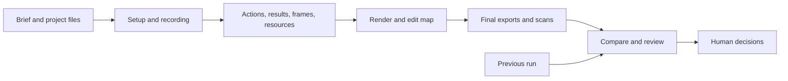

# Reshoot product and delivery plan

Date: 2026-10-19  
Code baseline: `1c9b029`  
Status: Proposed work. The commands, formats, and modules described below have not been implemented unless identified as existing.

This plan follows the [product review](../reviews/2026-10-19-product-review.md). It covers reliability, demo planning, Claude and Codex support, browser actions, review, updates, and output quality.

**Product focus**

My recommendation is to build for developers who maintain demos for software that changes regularly. The first users are project maintainers and small product teams making README clips, release demos, and short product explanations.

The promise is simple: create a demo with an agent, keep its source with the app, and update it without starting over. The distinguishing feature should be the update process: show which beats changed, check whether the intended result still appears, and make the new recording easy to review.

Claude and Codex should produce the same project files and use the same CLI. The harness helps write the story and fix problems; recording, assertions, rendering, and reports run without an LLM. This keeps routine runs usable in CI without a model account.

Start with browser and terminal demos on macOS and Linux. Keep existing macOS window recording, with its current limits. Windows, simulators, hosted editing, and interactive sales demos are outside this plan. Publishing stays with the owner. Supporting another harness should require packaging and testing, not another recording engine.

**The intended user experience**

For a new demo, the user describes the audience, the task, and the result worth showing. The agent inspects the app, prepares demo data, and writes a short story. The user gets a quick preview before spending time on a full render. The final files come with a review page that shows what ran, what passed, what changed, and what still needs a person's attention.

For an update, the user asks to refresh an existing demo. Reshoot resets the demo data, records the new app version, checks the expected results, and compares matching beats with the previous version. A broken selector produces a useful failure report. A changed result remains a failed expectation until the product behaviour or the story is deliberately changed.

No capture includes the whole screen. All fixtures use made-up data. Existing rules about commits, pushing, posting, and publishing still apply.

**Delivery order**

| Milestone | Result | Depends on |
|---|---|---|
| M0 | Failed or incomplete checks cannot look successful | Existing code |
| M1 | A fresh project can produce an isolated run and a quick preview | M0 |
| M2 | Claude and Codex can create and update a demo using installed skills | M1 |
| M3 | Browser actions and expected results are checked reliably | M1; M2 skills updated with it |
| M4 | A reviewer can compare releases and inspect the exact output | M1 and M3 |
| M5 | Outputs are readable in their intended formats, with external trial results | M2 through M4 |

M2 is the first release aimed at users of both harnesses. M4 delivers the update-and-review feature that should lead the product description. Each milestone should leave a usable tool; the fixes in M0 must not wait for the browser work in M3.

There is no calendar estimate yet. Two unknowns need a small prototype before scheduling M3 and M4: combining browser-native input with the animated cursor, and the cost of scanning every frame. Record their results and then estimate the remaining work.

**M0: Make the reports trustworthy**

Work in [run.py](../../src/reshoot/run.py), [check.py](../../src/reshoot/check.py), [scan.py](../../src/reshoot/scan.py), [web.py](../../src/reshoot/web.py), and [action.yml](../../action.yml).

1. Keep the app alive until recording and any URL-based checks finish. Put app shutdown and final report writing in cleanup that runs on success, failure, and interruption. Readiness should check a configured successful status or response, rather than accepting any HTTP error as a ready app.
2. Give check results an explicit error state. Missing sources, invalid manifests, failed fetches, unreadable images, detector crashes, and interrupted decoding must not become zero unchecked images.
3. Separate check exit codes: `0` for completed review, `1` for review pending, and `2` for an operational error. Report errors in structured data as well as the exit code. Other nonzero exits, missing reports, and reports from an earlier run are errors to the runner.
4. Keep `reshoot run` successful when all configured work completes and only human review is pending. Return an error when a required stage fails. Retain `ok` temporarily as execution success and add explicit scan and review statuses to the Action outputs. Never use `ok` as a claim that the video is safe or approved.
5. Restrict built-in email exclusions to reserved example domains. Remove exclusions based on names such as `user@`. Explicit project exceptions should identify an exact address or domain and remain visible in the report.
6. Remove secrets from displayed source URLs, filenames, exception messages, and reports. Use generated source IDs where a safe description is not possible. Avoid logging raw request headers or authentication material.
7. Remove stale narration metadata when `VOICE` is removed. Fail pending browser calls when the connection closes and add command, beat, navigation, and whole-run timeouts.
8. Report page errors against the relevant beat. Unexpected page errors fail the run; any allowed exception must be narrowly configured and shown in the report.
9. Correct the coverage language in the README, roadmap, CLI help, plugin description, skills, and guide. The existing check samples video frames. State the interval and available detectors rather than claiming every frame was checked.

Acceptance checks:

- Turn each reproduced review failure into a regression test. Include a missing PNG, corrupt PNG, missing manifest, failed local URL, check subprocess crash, and old review files from a previous run.
- Stop Chrome during a beat. The command exits within its timeout, saves a failure report, and stops the app it started.
- Record with narration, remove it, and record to the same output name. The edit contains no previous narration.
- Confirm fake secrets placed in source URLs and error messages do not appear in logs or public-facing reports.
- Keep the existing fast and browser tests passing. Update the skills and add fixed pitfalls to the guide with each fix.

**M1: Make setup and runs predictable**

Add three proposed commands: `reshoot doctor`, `reshoot init`, and `reshoot preview`.

`doctor` checks the tools needed by the selected project, their versions, fonts, browser availability, OCR support, and capture limits. Its human-readable output gives exact next steps; JSON output lets a harness read the result. It checks dependencies without installing tools or launching a recording. VHS is needed only for a terminal take, and a missing optional face detector is reported separately from a missing required text detector.

`init` creates a root `reshoot.toml`, a storyboard, demo-data setup and reset instructions, and an edit template. Package these templates with the installed tool. Never depend on a checkout of this repository or overwrite an existing file silently. Begin with a browser-only path so VHS is not required for the first demo.

`preview` runs the same setup, actions, and any declared expectations at lower output resolution with a faster encoder. It reports its settings and cannot replace the final render or inherit its review decision. Starting at a later beat replays the required setup and earlier actions without recording them. It does not assume application state can be restored from a screenshot.

Store each run under a unique directory, for example:

```text
takes/runs/<run-id>/
  run.json
  events.jsonl
  assets/
  takes/
  exports/
  review/
```

Write outputs to temporary paths and rename completed files into place. A failed run must not overwrite the previous usable output. Cache reusable narration separately, keyed by text and engine settings; run-specific metadata points only to files used in that run. Stream captured frames to disk or a bounded queue rather than retaining an entire long recording in memory. Record any capture gaps or dropped frames.

Add a version to the configuration. New configurations resolve paths relative to their file. Existing configurations retain their current working-directory behaviour until migrated. Diagnostics show resolved paths, and migration is explicit.

Acceptance checks:

- Install the built wheel in a clean temporary environment. Generate and run the notes demo using only packaged resources.
- Reset and record the same demo three times without duplicated data or reused sidecars. Demonstrate cleanup after a failed setup.
- Verify overlapping runs use separate output directories. Projects that share a mutable database or fixed port must either isolate it or refuse concurrent execution.
- Compare preview and final runs: action order and expectations match, while output quality differs as declared.
- Exercise both the legacy configuration and the new path rules from a directory outside the project root.

**M2: Ship useful skills for Claude and Codex**

Keep [skills/](../../skills/) as the source for skill instructions. Package those instructions with the wheel and plugin, using the build configuration rather than maintaining separate handwritten copies. Put reusable project templates in the CLI package; skills ask `init` for them. Any skill-specific reference must travel with that skill. Declare the compatible CLI version and check it before using newer commands.

Provide three main entry points: `reshoot-demo`, `reshoot-refresh`, and `reshoot-review`. Keep the existing recording and editing skills as focused supporting instructions, with a documented name transition. Avoid exposing two copies of the same skill in a single harness.

At M2, refresh reruns an existing storyboard and returns review sheets. It does not yet compare releases. Result checks use explicit assertions in Python storyboards until M3 adds the declarative form. Document the current browser-input limits and repeat the harness trials when M3 and M4 replace these steps.

Codex discovers repository skills in `.agents/skills`; Claude supports `.claude/skills` and plugin skills. Use those locations for local installation tests, and supply Codex metadata where useful. Keep the current Claude plugin route. Document the matching Codex installation and a local installer that copies a complete skill bundle into the chosen scope, lists its changes, and refuses unrelated overwrites. Public plugin listings are a separate distribution step. [Official OpenAI documentation](https://learn.chatgpt.com/docs/build-skills), [Claude documentation](https://code.claude.com/docs/en/skills).

Improve the planning instructions before adding more production options. A demo brief records the audience, problem, task, result, destination, length, and next action. Each result beat explains what the viewer should learn and how the agent will check it. Prefer one complete useful task over a list of features. Ask only for missing information that affects the story; use existing project context where it answers the question.

Keep these instructions in the skills themselves: use demo data, run setup checks, inspect the result, distinguish pending review from success, and respect the owner's publishing instructions. Remove the claim that creating a local workflow file is the same as pushing it. Do not depend on the plugin's root `CLAUDE.md` being loaded.

Acceptance checks:

- Validate frontmatter, packaged references, templates, declared versions, and plugin manifests in ordinary CI.
- Install each bundle outside this source checkout and verify that every referenced file is available.
- Run the same small task through Claude and Codex: create a demo, preview it, record it, then refresh it after a deliberate UI change. Save harness and model versions, prompts, outcomes, interventions, and resulting artifacts.
- Include implicit discovery, explicit invocation, missing dependencies, unavailable capture methods, an ambiguous selector, and a failing result check.
- Run each main task at least three times per harness. Record failures rather than selecting only a good run. These are integration checks, not a claim about all models or harness versions.
- Review the resulting videos as well as the logs. Keep live harness checks separate from deterministic CLI tests and mark them untested when credentials or access are unavailable.

**M3: Add reliable browser actions and expected results**

Introduce a declarative storyboard for the common case. Keep Python storyboards and edit scripts as supported advanced inputs. Normalize both into a shared run record, but label arbitrary legacy JavaScript accurately: an action or expected result that reshoot cannot inspect remains unverified.

A proposed TOML beat might look like this:

```toml
schema_version = 1
id = "find-note"

[[beat]]
id = "search"
purpose = "Show that a saved note can be found by its words"
caption = "Find a saved note"
hold = 2.0

[[beat.action]]
type = "type"
target = { test_id = "search" }
text = "bike"

[[beat.expect]]
type = "text"
target = { test_id = "note-result" }
contains = "Pick up the bikes"
```

Validate IDs, actions, locators, timing, and output sizes before starting the app. Support a small action set first: click, type, key, scroll, navigation, and wait. Expectations cover visible text, counts, state, and URLs. A text expectation also checks visibility. Record the actual result, assertion time, and a screenshot before the next beat can alter it.

Prototype Playwright's Python API as the driver. Its locators check uniqueness, visibility, stability, whether an element receives events, and whether it is enabled. Playwright also exposes a Chromium CDP session, which may let reshoot retain its existing capture technique. Compatibility with cursor timing, navigation, and frame timestamps still needs testing. [Action checks](https://playwright.dev/python/docs/actionability), [CDP sessions](https://playwright.dev/python/docs/api/class-cdpsession).

Keep the overlay responsible for presentation: cursor, ripple, caption, and blur. The Python driver performs input. Moving the drawn cursor must not activate controls. Check the target again before the native click, handle layout movement, and never silently use forced clicks or JavaScript activation to get past a failure.

Adopt Playwright for new storyboards if the prototype passes. Keep the old engine behind the legacy Python path during migration. Both must write the same artifact format. Do not add a permanent general-purpose backend framework for two implementations of the same browser task.

Pin supported browser and Playwright versions, use a seeded cursor rhythm, and record locale, timezone, viewport, fonts, and tool versions. Projects provide reset commands and fixture versions. Mocked or replayed application responses must be identified in the demo brief and report; they are not evidence of live service performance.

Acceptance checks:

- A covered, disabled, absent, or ambiguous target fails with the beat name and a screenshot.
- A click that succeeds but produces the wrong result fails its expectation.
- Test React forms, full navigation, dialogs, nested scrolling, iframes, shadow DOM, and file upload using synthetic fixtures. Unsupported actions receive explicit errors.
- Existing notes storyboards still run. New declarative storyboards cover the same flow with assertions.
- Make `rec` emit the new format for supported interactions and identify unsupported ones. It must not silently drop actions it cannot reproduce.
- Measure runtime, memory, timing, and visual quality against the current notes recording before choosing the new default. Keep the measured results with the decision.

**M4: Compare and review the actual output**

Capture image and media response bodies through the recording browser where possible. Save them by content hash, without authentication headers or raw secret-bearing URLs. List unresolved resources explicitly, including streamed media and cached or browser-generated content that cannot be captured. Required missing sources fail the check. An asset inventory alone never claims to cover canvas, text, or everything visible in the video.

Provide two scan modes. Quick mode samples frames and reports the interval and sample count. Full mode streams every decoded frame of each final export through the configured detectors. Exact duplicate pixels may reuse a scan result; approximate image similarity must not skip briefly visible content. Count frames inspected, decoding failures, detectors used, and their versions. Full frame coverage still does not guarantee that OCR or detection found every private detail.

Support review against the final video, GIF frames, and captions or narration text as applicable. Persist detector results separately from human decisions. Changing a watch list or detector version invalidates its cached scan results. A new render needs its own review, even when some source images were previously accepted.

Before linking beats to finished edits, make the cut helpers write an edit map from source times to output times. Include trims, placement, concatenation, and speed changes. Custom ffmpeg work that supplies no map remains reviewable by final timestamp, but cannot claim accurate beat links. Scan final exports directly so privacy findings always retain their actual output times.

Add proposed `reshoot compare` and `reshoot review` commands. Compare runs by stable beat ID and expectation results. Show aligned frames, actual durations, story edits, environment differences, and added or removed beats. Pixel differences are a review aid, not a verdict on correctness. Animation and timestamps may explain differences; any comparison mask must be explicit and must never suppress privacy scanning.

Start with a generated local HTML page and bundled assets. It opens the videos, jumps to findings, displays full-resolution frames, and compares beats. A reviewer can export decisions as JSON for CLI import. Validate run IDs and artifact hashes when importing. This avoids introducing a persistent web service just to review files. The HTML must escape captured text and treat all recorded content as data.

A baseline is a run explicitly chosen for comparison. It does not update itself after a successful render. Human decisions identify the run, artifact hashes, and review policy; they do not carry over merely because the beat name matches. A changed policy or new finding needs a new decision even if the media is unchanged. Review records should say what was reviewed, without claiming tamper-proof identity or attestation.

The refresh skill orchestrates reset, run, comparison, and any authorized local repairs. Suggest selector changes with evidence, rerun the affected flow, and preserve the expected result. Changes to the product claim or fixture meaning must be called out. Partial preview replay is useful for repairs, but final acceptance uses a full fresh run.

Acceptance checks:

- Detect a brief synthetic privacy marker in full mode; show that quick mode may miss it and reports its narrower coverage.
- Review saved resources after shutting down the app and disconnecting from its URLs.
- Refuse an approval imported for another run or changed export. Preserve prior decisions when the report is regenerated for unchanged artifacts and policy; leave new findings unresolved.
- Compare runs where beat durations differ, selectors change, results change, and beats are added or removed.
- Keep unexpected result changes failed even if images look similar. Do not promote a new baseline automatically.
- Keep report and decision formats usable from the CLI without opening the HTML page.

**M5: Improve the output and test the product with users**

Add a simple edit file for ordinary cuts: ordered beat ranges, title and end cards, speed changes, narration, music, and export profiles. Keep the Python edit API for custom work. Both use the edit map introduced in M4. Apply it to subtitles, narration, and source annotations so a cut or speed change cannot leave them at the old time. Final-output findings retain the timestamps measured by their scan.

Export profiles describe size, frame rate, file budget, caption placement, and minimum reading time. Begin with landscape video, portrait video, and README GIF. Portrait uses a responsive take or an intentional crop; the landscape-on-background layout remains an explicit choice. Do not rerun the workflow for every format when reframing the same recording is sufficient.

Add reusable project colours, fonts, a logo, safe margins, wrapped captions, and a poster frame. Trim only marked waiting sections after the expected result has appeared. Protect narration and reading holds. If a shortened wait could imply faster performance, label the edit. Validate current platform limits when adding named platform presets.

Fix the notes terminal segment so its label matches what it actually does. Add a synthetic before-and-after app version to demonstrate the complete update process. Keep generated recordings out of source fixtures; record them when validating a release.

Try the workflow with three to five external projects, using only made-up data and authorized environments. Include at least a static app, an app with a backend, and a browser-plus-CLI flow. Measure first-demo time, update time, manual interventions, review time, and successful runs. Compare an update with redoing the same demo using the team's existing method. Record machine and tool versions so timings have context.

Proposed trial targets, to confirm after measuring M1:

- With dependencies and demo data ready, a new user reaches an acceptable short preview within 15 minutes.
- At least eight of ten agreed update cases complete without manual video editing. Report how many require story or selector changes separately.
- Every deliberately broken expectation is reported as failed; no unavailable scan is reported as completed.
- A reviewer can inspect every finding at its exact location and tell whether it still needs a decision.

These are product targets, not measured results or deadlines. If setup and repair effort remain high, improve them before expanding capture platforms.

**Architecture and data**

Keep one Python application with file-based artifacts. Reuse ffmpeg, VHS, the existing zoom renderer, and the window recorder. Add modules as their milestone needs them:

| Area | Responsibility | Proposed code location |
|---|---|---|
| Configuration | Validate the project and normalize supported storyboard inputs | `config.py`, `story.py` |
| Run lifecycle | Start and stop processes, enforce timeouts, isolate outputs | Existing `run.py`; shared records in `artifacts.py` |
| Browser | Drive actions, collect evidence, capture frames and resources | Existing `web.py`; `browser.py` if separation is needed |
| Rendering | Apply camera work and edits; write time mappings | Existing `zoom.py`, `cut.py`; `timeline.py` |
| Checking | Decode sources, run detectors, describe coverage | Existing `check.py`, `scan.py` |
| Review and comparison | Read artifacts, compare beats, generate the local page | `compare.py`, `review.py` |
| Installation | Supply templates and complete harness skill bundles | `init.py`, packaged resources, existing `skills/` |

The data flows in one direction:



Use a versioned `run.json` as the index. It references append-only events, source hashes, outputs, and decisions. Record the app commit and dirty state, storyboard and fixture hashes, actual tool versions, capture settings, beat times, assertions, exceptions, resource gaps, and final artifact hashes. A hash records which input was used; it does not by itself make an external service reproducible.

Represent execution, expectations, scan coverage, and review as separate fields. Use states such as `pending`, `passed`, `failed`, `partial`, `skipped`, and `unavailable` where they apply. Include a reason for anything other than success. A requested required detector that cannot run is an error; an intentionally disabled detector is recorded as skipped. Never infer review completion from an empty findings list.

Keep project source and generated media separate. Runs reference their own files and do not execute code from a review bundle. Persist only the data needed to reproduce or inspect the demo, with explicit cleanup for old runs. No database, hosted service, MCP server, or model dependency is needed for this plan.

**Compatibility and CI**

Existing Python storyboards, VHS tapes, and edit scripts remain runnable. They write the new report format through adapters and show missing verification explicitly. Preserve sidecar compatibility during a documented transition, and distinguish old byte-level image acceptance from review of an entire new render.

The current `[keep]` behaviour copies generated files into tracked destinations before human review. Preserve it for legacy configurations with clear pending-review output. New projects keep candidates in the run directory; an explicit local export copies chosen files to configured destinations. That export does not commit or publish them.

CI runs configuration validation, fast tests, browser fixtures, wheel installation tests, package-reference checks, and a complete notes shoot on supported runners. Pin release actions and record tool versions. Action outputs distinguish recording failures, scan errors, findings, and pending review. The sample workflow must not open a PR after an operational error. Adding or executing a workflow still follows the owner's existing authorization.

Every CLI or overlay change includes the affected skill, help text, examples, and guide updates. Each fixed review pitfall gets “Fixed in reshoot” in the guide. Public-facing claims follow demonstrated behaviour on the tested platforms.

**First implementation batches**

| Batch | Scope | Completion evidence |
|---|---|---|
| 1 | Check errors, lifecycle cleanup, and truthful report states | Regression tests for the reproduced failures; Action output checks |
| 2 | Email exclusions, safe source descriptions, stale narration, and browser timeouts | Synthetic privacy and interruption tests; no old audio |
| 3 | Versioned run artifacts, isolated outputs, and configuration validation | Failure recovery, concurrent-run, and legacy compatibility tests |
| 4 | Packaged templates, `doctor`, `init`, and preview | Clean wheel installation and first browser demo |
| 5 | Story brief and complete Claude/Codex bundles | Package checks and recorded harness trials |
| 6 | Browser prototype, declarative actions, and expectations | Recorded driver decision and the synthetic interaction suite |
| 7 | Saved resources, full scan mode, edit map, comparison, and review page | Offline review, brief-marker test, aligned comparison, decision import |
| 8 | Edit file, output profiles, main demo, and external trials | Correct timing across exports and measured user results |

Split a batch when it stops being reviewable. Do not combine the urgent check fixes with a browser rewrite. Update the main roadmap as milestones are accepted, and keep the dated review as the record of the original findings.
