# How the videos look

Every picture here comes from the bundled notes example, recorded by
[`examples/look/build.py`](../examples/look/build.py). Each one changes a
single setting, or combines them in a reusable visual style. Run the script again to bring the page up to
date.

## Clickable tour

The same checked notes task becomes a single HTML walkthrough. Next, the
numbered marker and keyboard arrows move between captured result screens.
The embedded images, words and navigation work offline.

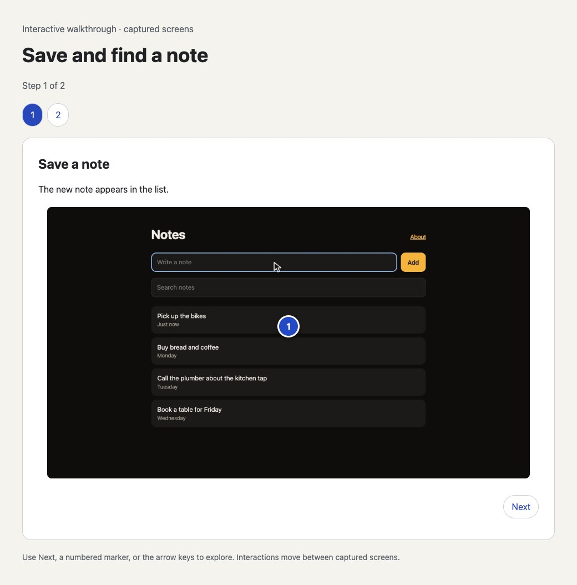

[Download the offline notes walkthrough](../docs/look/notes-tour.html), then open
the HTML file in a browser. Create and edit one in the studio's **Clickable tour**
panel; see [offline tours](customize.md#make-an-offline-clickable-tour).

## Documentation screenshots

A selected result frame becomes a PNG beside the videos. This is the captured
page after the search checks passed, without the video's caption, camera zoom
or decorative frame. The recorded cursor may remain visible. It is a viewport
image, not a stitched full-page capture.

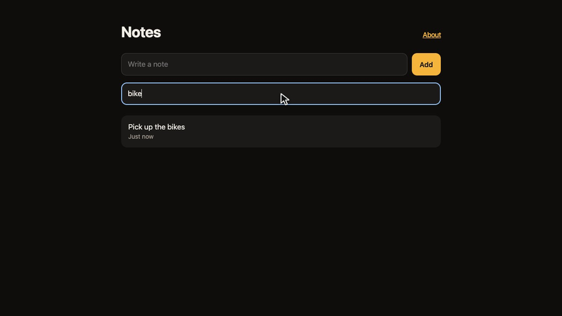

Choose **Use for docs** beside a checked step in the studio, describe the image,
save it and update the preview. Its name stays stable across fresh recordings.
See [documentation screenshots](customize.md#keep-documentation-screenshots-current)
for cropping, local export and refresh review.

## Visual styles

Choose a complete look in the studio's **Style and exports**, or apply one
from the command line. Each changes caption colours and placement, title-card
colours and browser framing. Fonts, story content, timing, audio and exports
stay as they are. The app is large in Focus; the framed styles give it a
background and slightly shrink it, so check text at the exported size.

| Focus | Midnight | Paper |
|---|---|---|
| 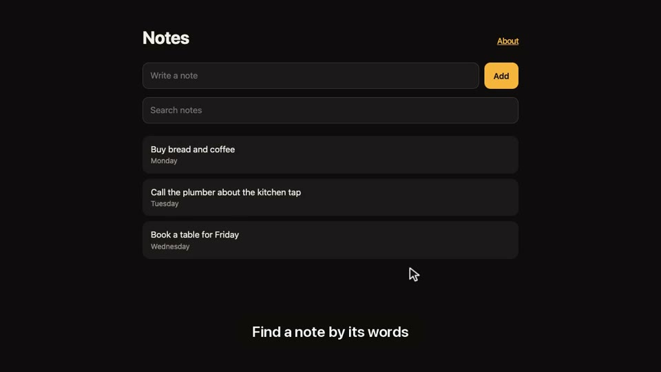 | 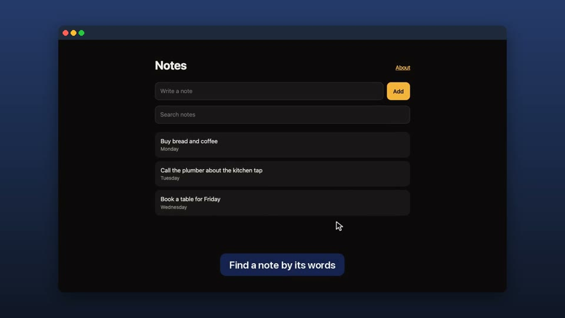 | 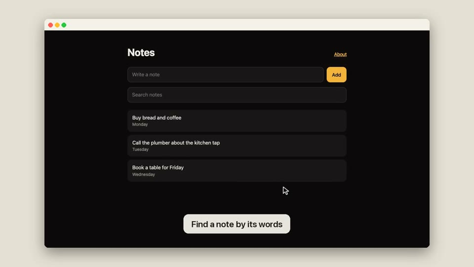 |

```bash
reshoot style apply midnight --project demo
reshoot recut demo/latest
```

Save your own look and use it in another project with
[reusable styles](customize.md#reuse-a-visual-style).

## Beat cuts and sequence

This cut shows the search result, then how the note was created, then the
result again. The app still runs once in its original order and verifies all
three result checks. Only the video parts move. `through` includes the last
beat and its reading hold; `end` stops at the named beat's start.

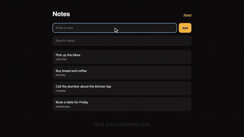

```toml
[[part]]
take = 0
start = "search"
through = "search"

[[part]]
take = 0
start = "intro"
through = "add"

[[part]]
take = 0
start = "search"
through = "search"
```

The studio's **Your cut** edits these ranges and their order, with Undo and
Redo. See [trim and arrange the video](customize.md#trim-and-arrange-the-video)
for the CLI equivalents. Update preview reuses a current recording and
retains repeated captions and narration at their new times.

## The cursor

The cursor glides along a slight curve, taking longer for longer trips,
presses down with a ring on each click, and types at an uneven pace. It is
drawn on the page, so it is in every recording without editing.

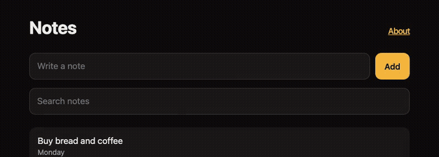

```toml
[cursor]       # in storyboard.toml; these are the defaults
size = 1       # 0.5 to 3 times the arrow
typing = 13    # characters a second
ripple = true
```

## Auto-zoom

With `zoom = true`, the camera follows the action after recording: it starts
moving before a click, so it lands as the click happens, eases in on a
critically damped spring, stays put through short pauses, and pulls back when
something changes elsewhere on the page. Captions are drawn after the zoom, so
they stay where they are.

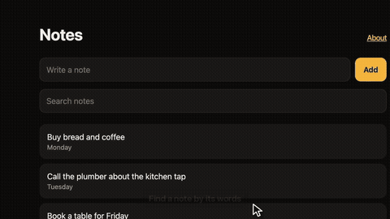

| `zoom` off | `zoom = true` |
|---|---|
| 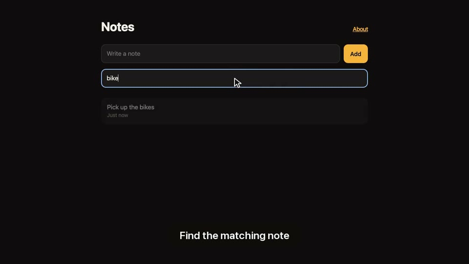 | 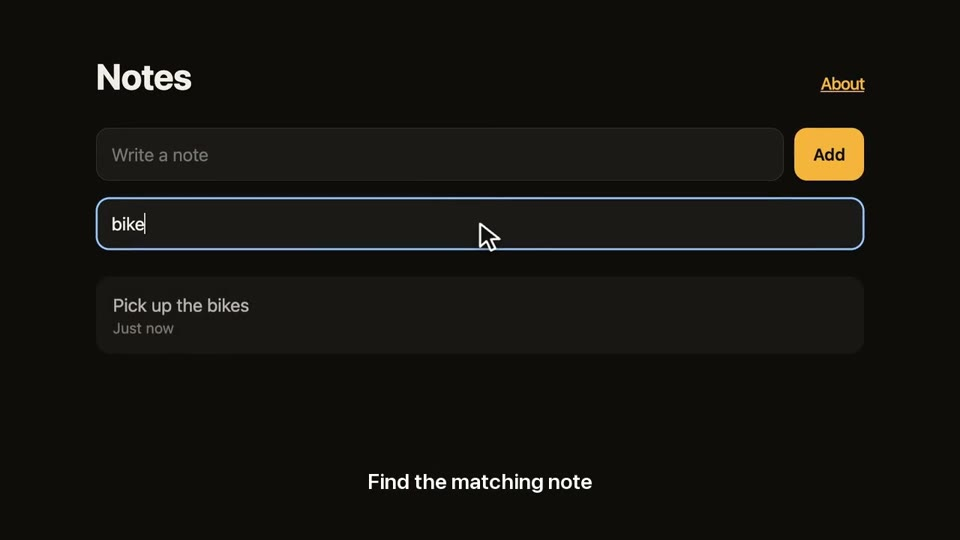 |

The page is recorded at up to twice its pixel ratio while zoom is on, so text
stays sharp as it zooms in. For larger text without zoom, use a narrower
viewport, such as `size = "960x540@2"`.

## Captions

Captions sit at the bottom by default. A `[caption]` table sets their colors,
margin, font and minimum time on screen, and `position = "top"` moves them up,
which suits apps whose content sits low; check that they don't cover a
heading.

| Default | Styled |
|---|---|
|  | 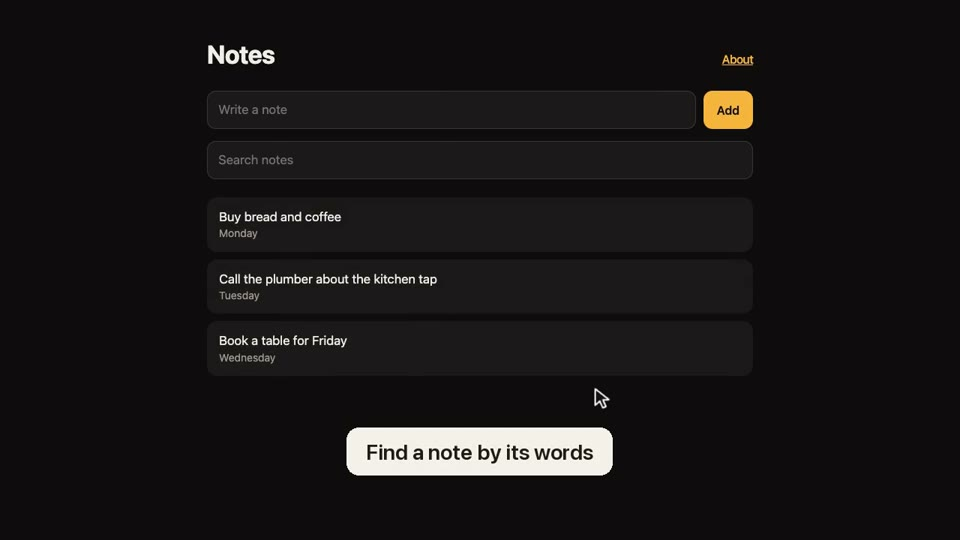 |

```toml
[caption]
background = "#f4f1ea"
foreground = "#1d1b18"
margin = 0.12
```

## Title cards

A `card` part in `edit.toml` adds a still title, colored by `[style]`, which
can also set a font and a logo.

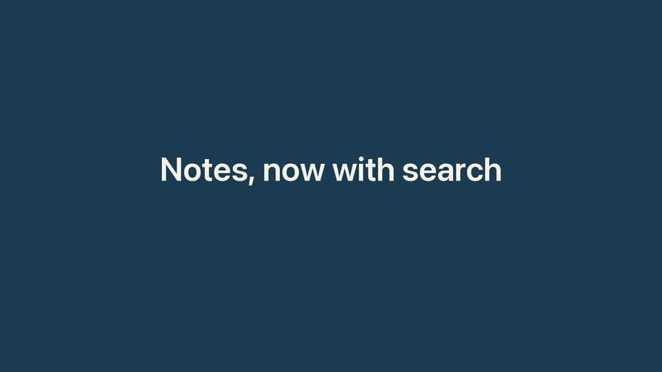

```toml
[style]
background = "#1d3b53"
foreground = "#f4f1ea"

[[part]]
card = "Notes, now with search"
duration = 2
```

## A browser frame

A `[frame]` table in `edit.toml` puts each take in a window with a title bar,
rounded corners and a soft shadow, on the `[style]` background: one colour, or
a top and bottom colour for a gradient. Title cards stay full size. The page is
shrunk to fit, so text gets smaller: frame a recording whose text is large
enough already.

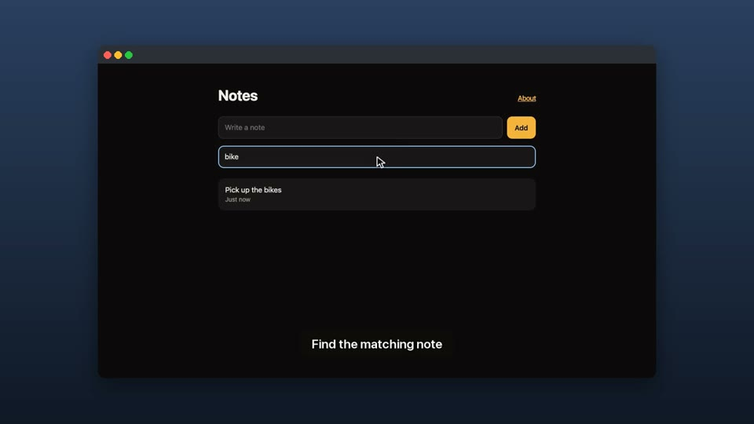

```toml
[style]
background = ["#2a3f5f", "#101826"]

[frame]
padding = 0.06   # each side, as a fraction of the width; these are the defaults
radius = 12      # corner radius in pixels
shadow = true
bar = true       # the title bar with three dots
```

## Shapes

An `[[export]]` profile makes another size from the same recording.
`fit = "contain"` fits the whole frame in, so the text shrinks; `fit = "crop"`
fills the shape from the middle, so the text stays large but the edges go. For
a portrait video people read on a phone, record a narrower viewport, or a take
of its own.

| 16:9 | 4:5, fit = "contain" | 4:5, fit = "crop" |
|---|---|---|
| 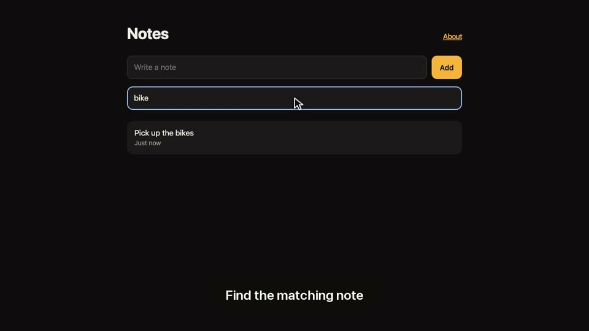 | 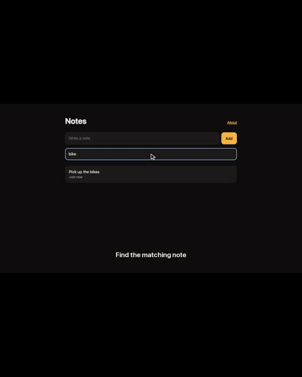 | 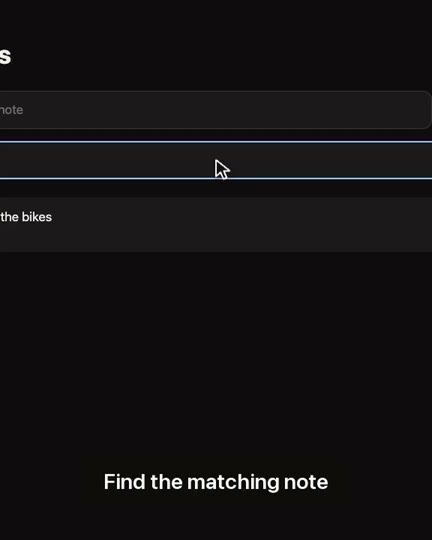 |

```toml
[[export]]          # in edit.toml
name = "crop"
format = "mp4"
width = 1080
height = 1350
fit = "crop"
```

The `x`, `linkedin` and `readme` [presets](projects.md#export-presets) make
these shapes for a platform and check its limits.

## Destination framing and readability

Each export can Fit the whole video or Crop to fill its shape, with horizontal
and vertical crop positions. The studio's crop guide helps aim it; Update
preview renders the choice. A crop can cut off a caption or checked result.
These are the centre and right-biased versions of the same held notes result:

| Centre crop | Right-biased crop |
|---|---|
|  | 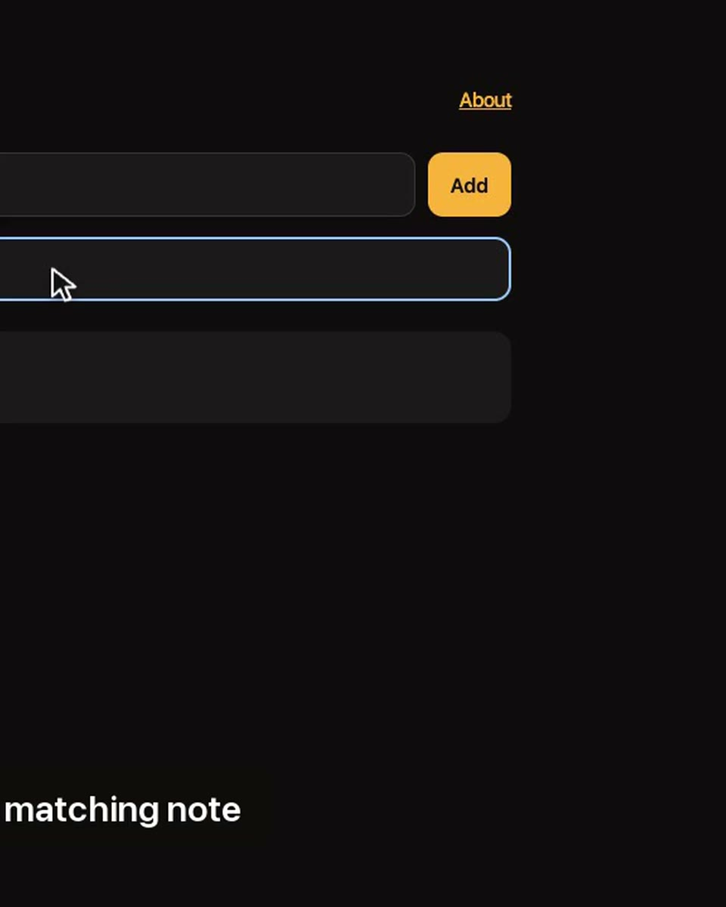 |

```toml
[[export]]
name = "crop-right"
width = 1080
height = 1350
fit = "crop"
focus = [0.85, 0.5]
display_width = 390
```

The same geometry frames MP4 and GIF. `focus` uses fractions from 0 (left or
top) to 1 (right or bottom). Viewing width changes inspection and text-size
estimates, not encoded dimensions. The gallery's measured values are:

| Export | Viewing width | Small app-text samples | Smallest caption text |
|---|---|---|---|
| contain | 640 px | 7.0 px | 14.5 px |
| crop | 640 px | 15.6 px | 32.2 px |
| crop-right | 390 px | 10.8 px | 19.6 px |

These are editing hints from sampled main-page text and rendered caption
geometry. They do not establish readability or accessibility. Camera zoom,
custom placement, iframe or canvas text need visual inspection. The studio's
**Inspect at viewing size** keeps the requested width, with scrolling when
needed. See [destination framing](customize.md#frame-and-inspect-a-destination)
for the controls and CLI. `reshoot frame check demo/latest` reads the measured
feedback bound to that run.

## GIF size

A README GIF is made with its own palette. `max_bytes` in an export profile
fails the export if the file comes out larger, so a GIF never silently grows
past a page's limit. The notes example's loop:

| Width | File |
|---|---|
| 800 wide (the default) | 333 KB |
| 640 wide | 236 KB |

## Sound

A voiceover is spoken before recording, so each beat waits for its line.
Music plays under it and ducks while someone speaks, then fades out at the end.
See [Grow it into a fuller demo](customize.md#grow-it-into-a-fuller-demo).
