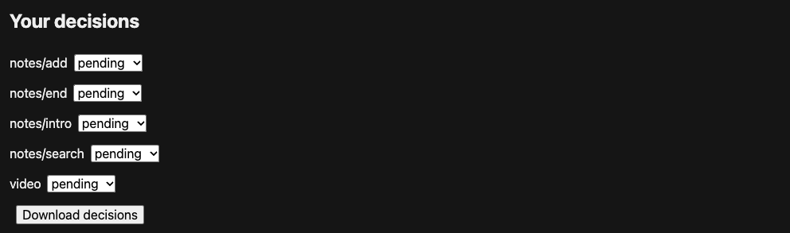

# Make a demo, then update it

To have Codex or Claude Code make a demo of your app, use the
[agent quickstart](agent-quickstart.md). This tutorial teaches the CLI workflow
directly with a bundled example.

Start with the bundled notes app. It saves a made-up note, searches for a word,
and checks that the matching note appears. This tutorial produces an MP4 and a
README GIF, then repairs the recording after a small app change.

Install the [CLI and dependencies](install.md), then run the commands in
one terminal, from a writable folder where a new `demo/` directory can be created.
No repository checkout, VHS, AI account or real user data is needed.

## 1. Create a project

```bash
reshoot init demo
reshoot doctor --config demo/reshoot.toml
```

The first command creates:

```text
demo/
  .gitignore        Keeps the recordings in takes/ out of Git
  BRIEF.md          Who the demo is for and what it proves
  index.html       The made-up notes app
  about.html       A second example page
  storyboard.toml  Actions, captions and result checks
  edit.toml        Which parts to keep and which formats to write
  reshoot.toml     App startup, recording, edit and scan settings
```

Keep this terminal in the folder containing `demo`, rather than changing into
it. All commands below use that same working directory. If the directory already
exists, `init` refuses to overwrite its files; choose another name or continue
with the existing project.

`doctor` should report ffmpeg, ffprobe, Chrome and Playwright available, and a
text detector installed. Resolve missing dependencies before recording. On Linux,
Tesseract reads text; faces and people need visual inspection.

## 2. Record a preview

```bash
reshoot preview demo/reshoot.toml
```

Reshoot starts its own local notes server on port 8765, or on the free port
`reshoot init` chose if 8765 was in use. It records a browser page,
cuts the video, writes a GIF, checks the outputs, and stops its server. It never
captures the desktop. The notes reset on each new page load.

It ends by saying what it made:

```text
Done in 13 s: 3 of 3 result checks passed · scan: 6 items, 0 flagged · not accepted yet.
  video  demo/takes/runs/RUN_ID/takes/demo-final.mp4
  GIF    demo/takes/runs/RUN_ID/takes/demo-final-readme.gif
  review demo/takes/runs/RUN_ID/review.html

This is a preview, smaller and quicker than a final. When it looks right, record the final:
  reshoot run demo/reshoot.toml
```

Open the GIF, the video or the review page from the paths it printed: on
macOS with `open PATH`, on a Linux desktop with `xdg-open PATH`, or with a
browser's File > Open. Each run has its own folder under `demo/takes/runs/`,
and `reshoot runs demo` lists them.

The note “Pick up the bikes” should be saved, then remain as the single result
for “bike”. The three result checks are in the save and search beats; the
`intro` and `end` beats have none, so the review page labels them
`unverified`.

Use the preview to catch wrong actions or unreadable captions before making
the final recording. If a command fails, it prints the run folder and failure
image; see [Troubleshooting](troubleshooting.md).

You have the first clip. Stop here to [explore features](features.md) or
[change captions, timing and export size](customize.md). Continue below when
ready to learn final review, updates and comparison. To record your own target,
choose [source code](your-app.md), a [running URL](running-web-app.md) or a
[macOS window](macos-window.md).

## 3. Make a final recording

```bash
reshoot run demo/reshoot.toml --full
```

`--full` checks every decoded frame of both final exports, reusing exact
duplicates. Without it, a run checks samples every three seconds, which could
miss brief content, as previews do to stay quick. Full checks take longer and
still need a person's review. To make every final full, set `full = true` in
the `[check]` table of `demo/reshoot.toml`.

The final's folder contains these files, plus evidence frames and other
metadata:

```text
run.json
review.html
review/
  report.json
  key.json
  flags.json
  01.jpg, 02.jpg, ...
  originals/
takes/
  demo.mp4                 Original browser take
  demo.take.json           Beat results and captured environment
  demo-final.mp4           Finished 1280×720 video
  demo-final.srt           Subtitles
  demo-final-readme.gif    800×450 loop
app.log                    The notes server's own output
```

Open the new `review.html` and watch both finished exports. Check the note,
search result, caption timing and loop. The bundled edit stops at the start of
the `end` beat; that beat's extra half-second hold is not in the finished cut.

## 4. Accept the recording

Accepting says two things: the recording shows the task clearly, and nothing
in its frames or captions should stay private. A clean automatic scan decides
neither.

On the final's review page, watch both exports to the end. Below them, any
item the scan flagged comes first, with its frame and what was found. Then the
scan sheets: each holds up to four labeled images, such as `1-1` and `1-2`, and
"Each item at full size" links every label to its original. Look for
unintended names, accounts, tokens, paths or people. In this tutorial all app
data is made up, so a quick look over the unflagged sheets is enough.

When everything is acceptable, run:

```bash
reshoot accept demo/latest
```

`demo/latest` stands for the newest successful run, here the final. Use a run's
folder instead to pick another. `accept` refuses a preview. It lists the exports, beats and scan items it covers and asks you to confirm.
It then records the verdict for all of them, bound to the run's exact files and
scan policy, and writes `demo/accepted/`, a small record of the run. From now
on `demo/accepted` stands for this run. A later change to a file or the scan
policy invalidates the verdict.

If the scan found something, `accept` stops and lists each finding once, with
the frames it is in, such as `F1  email sam.•••: 318 frames, 1-1 to 80-2`.
Inspect it at full size on the review page, then name the findings you accept:

```bash
reshoot accept demo/latest --flagged F1
```

If an item must not be shared, reject it instead:

```bash
reshoot accept demo/latest --reject F1
```

That marks the run failed. Fix the demo data or story and make a new recording;
a rejected take still contains the problem.

To give separate verdicts per beat, use the **Your decisions** controls at the
end of the review page, click **Download decisions**, and import the file with
`reshoot review RUN_FOLDER --import-decisions FILE`. Most reviews do not need this.



## 5. Change a caption

In `demo/storyboard.toml`, change the intro caption:

```toml
caption = "Find the note you need"
```

Leave the beat ID `intro` and the result checks intact, then record a preview:

```bash
reshoot preview demo/reshoot.toml
```

Open this new preview as in step 2. It should show the new words while performing
the same task. The accepted final remains unchanged.

## 6. Change the app and repair the story

Run this once to change both the search input's HTML ID and its JavaScript
lookup. It edits only the tutorial's made-up app:

```bash
python3 - <<'PY'
from pathlib import Path
app = Path("demo/index.html")
text = app.read_text()
assert 'id="q"' in text and 'querySelector("#q")' in text, "App already changed?"
text = text.replace('id="q"', 'id="note-search"')
text = text.replace('querySelector("#q")', 'querySelector("#note-search")')
app.write_text(text)
PY
reshoot preview demo/reshoot.toml
```

The preview should fail on `#q`: the app now calls that input `note-search`.
This is an expected failure. It prints the beat that failed, the run folder
and the failure image, a frame of the page when the search box wasn't found.
Earlier passed checks do not prove the interrupted search worked.

In `demo/storyboard.toml`, change only the search target:

```toml
target = {css = "#note-search"}
```

Keep the search beat ID, note text, search word and expected count and text.
Then record a repaired preview and a fresh final:

```bash
reshoot preview demo/reshoot.toml
reshoot run demo/reshoot.toml --full
```

Both should end with all three result checks passing. Compare the new final
with the accepted one:

```bash
reshoot compare demo/accepted demo/latest --out demo/comparison.json
reshoot review demo/latest --previous demo/accepted
```

`compare` prints which beats matched and which changed their steps or results:

```text
Compared run NEW_ID with ACCEPTED_ID. Beats: 4 matched.
  notes/intro: matched, changed steps
  notes/search: matched, changed steps
Result checks passed before, passed now. Wrote demo/comparison.json.
```

The intro caption and the search target changed; the task and its result did
not. Four matched beats means the same beats were found, not identical pixels.
Open the new run's `review.html` to see the old and new videos and GIFs
together, with each beat's evidence frames side by side.

## 7. Review and export the update

Repeat step 4 for the new final, including its fresh scan sheets, and accept
it with `reshoot accept demo/latest`. The earlier verdict covers the earlier
run only. `demo/accepted` now stands for the update.

Copy its video, GIF and subtitles to a local directory:

```bash
reshoot export demo/accepted --directory docs/demo
```

It copies `demo-final.mp4`, `demo-final-readme.gif` and `demo-final.srt`, and
prints the Markdown that shows the GIF in a README, linked to the video. Export
verifies source hashes and refuses to overwrite files unless given `--replace`.
It copies locally; it does not publish anything. `--file` picks single files.

If using Git, keep the brief, app fixtures, TOML files and their dependencies
under version control, with `demo/accepted/`. Accepting a run writes that small
record of it, so a fresh checkout or [CI](ci.md) can compare later runs with it.
`demo/.gitignore` keeps `demo/takes/` out; leave out downloaded review files
too.

For another app, continue with [Record your own app](your-app.md). For settings
and less common actions, see the [project reference](projects.md) and
[command map](commands.md). The [manual workflow](manual.md) covers Python
storyboards, VHS terminal takes and native app windows.
